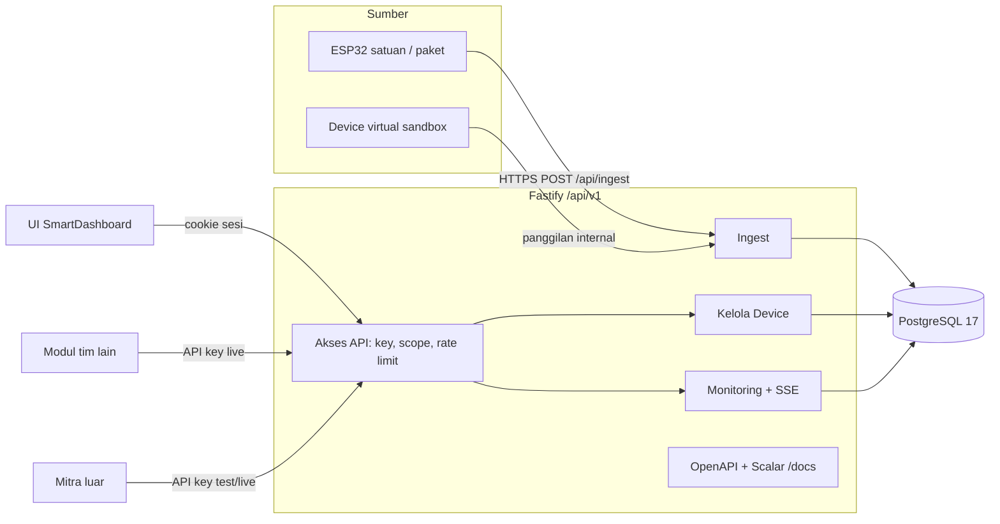
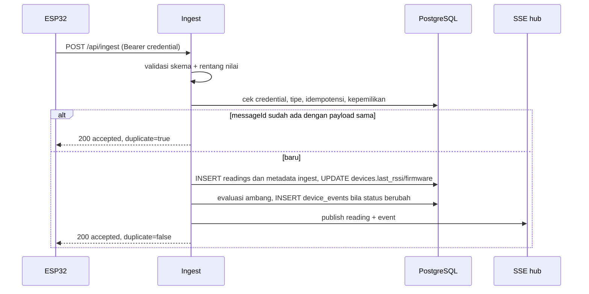

# Technical Design: IoT System JagoFarm

| Atribut | Isi |
| --- | --- |
| Pemilik | Haykal |
| Status | Draft v0.1 |
| Tanggal | 3 Oktober 2026 |
| Dasar | PRD v0.1, kode di `dev/antigravity` commit `3561116` |

## 1. Ringkasan

Backend pilot yang sudah ada (Fastify 5 + PostgreSQL 17) dikembangkan, bukan diganti. Semua fitur baru tinggal di bawah prefix `/api/v1`. Route pilot lama (`/api/*`) tetap jalan sampai `PilotApp.jsx` tidak dipakai lagi. Perubahan terbesarnya ada empat:

1. Model perangkat pindah dari konstanta `models` di `server/domain.ts` ke tabel (`sensor_types`, `device_types`, `device_type_sensors`).
2. Ada jenis kredensial ketiga, yaitu API key, di samping sesi cookie dan credential device.
3. Ingest v2 menerima IoT satuan (1 sensor) dan paket (beberapa sensor).
4. UI SmartDashboard mulai memakai sesi backend dan membaca data IoT dari API.

## 2. Arsitektur



Asumsi deployment: satu instance API. SSE, rate limit (`@fastify/rate-limit` memakai store memori), dan runner device virtual berjalan di proses yang sama. Kalau nanti lebih dari satu instance, ketiganya perlu dipindah ke Redis atau `LISTEN/NOTIFY` PostgreSQL.

## 3. Struktur kode yang diusulkan

`server/app.ts` sekarang satu file berisi 223 baris. Supaya bisa dikerjakan per minggu tanpa konflik, route baru dipisah:

```
server/
  app.ts                  # buildApp: plugin global, error handler, pendaftaran modul
  domain.ts               # hash, secret, connectionStatus (models dihapus setelah migrasi)
  db.ts                   # pool, transaction, migrate (bernomor)
  migrations/
    001_pilot.sql         # isi schema.sql sekarang
    002_iot_platform.sql
  auth/
    session.ts            # sesi cookie (pindahan dari app.ts)
    api-key.ts            # parsing Bearer jf_*, scope, environment
  v1/
    sensor-types.ts
    device-types.ts
    devices.ts            # CRUD, QR, claim, release
    ingest.ts             # v1 + v2
    readings.ts           # latest, riwayat teragregasi, overview per sensor
    events.ts             # log kejadian
    stream.ts             # SSE
    keys.ts               # API key + usage
  sandbox/
    runner.ts             # device virtual + skenario
  simulator.ts            # simulator jaringan (tetap)
```

## 4. Autentikasi dan otorisasi

### 4.1 Tiga jenis kredensial

| Kredensial | Bentuk | Dipakai oleh | Route |
| --- | --- | --- | --- |
| Sesi | Cookie `pilot_session` (64 hex), berlaku 12 jam | UI SmartDashboard, portal developer | Semua `/api/v1` sesuai role dan scope |
| API key | `Authorization: Bearer jf_live_<64 hex>` atau `jf_test_<64 hex>` | Modul tim, mitra | `/api/v1` sesuai scope |
| Credential device | `Authorization: Bearer <64 hex>` | ESP32, simulator | Hanya `/api/ingest` |

Urutan pengecekan di hook `preHandler`:

1. Route publik (`/api/health`, `/api/session/login`, `/api/invitations/accept`, `/api/ingest`, `/api/v1/devices?code=...`, `/docs`, `/docs/*`) dilewati. Pratinjau QR hanya mengembalikan ringkasan device yang aman.
2. Header yang cocok persis dengan `Bearer jf_(live|test)_<64 hex>` diproses sebagai API key. Server mencari baris dengan prefix, lalu mencocokkan `hash()` dari `domain.ts` dan memastikan key belum dicabut. Hasilnya `request.actor` membawa `kind`, `id`, `userId`, `email`, `role`, `scopes`, `environment`, dan `keyId`. Key tidak dikenal atau dicabut mendapat 401 `UNAUTHENTICATED`.
3. Jika bukan API key, cookie sesi dicek lewat `server/auth/session.ts`. Perilaku token SHA-256, masa berlaku 12 jam, dan bentuk response sesi pilot tetap sama. Sesi `user` mendapat `devices:read`, `devices:write`, `readings:read`; sesi `admin` mendapat keempat scope. Sesi `partner` tidak mendapat scope API langsung dan hanya dapat membaca sesi serta mengelola API key miliknya.
4. Tidak ada kredensial yang valid berarti 401. Pengelolaan key di `/api/v1/keys` hanya menerima sesi cookie, bukan API key.

Pengecekan Origin (proteksi CSRF) di hook `onRequest` hanya berlaku untuk request ber-cookie. Request dengan API key tidak membawa cookie, jadi tidak rentan CSRF dan tidak boleh ditolak karena tidak mengirim `Origin`. Kalau request membawa cookie dan API key sekaligus, request ditolak 400 supaya tidak ambigu.

### 4.2 Scope

| Scope | Mengizinkan |
| --- | --- |
| `devices:read` | `GET` devices, device-types, sensor-types |
| `devices:write` | Klaim, release, ubah nama device miliknya |
| `readings:read` | latest, readings, overview, events, stream |
| `admin` | CRUD sensor-types dan device-types, registrasi device, lihat semua device. Hanya bisa dibuat oleh akun `admin` |

Setiap route mendeklarasikan scope di `config.scope`. Hook `preHandler` mencocokkannya dengan `request.actor.scopes`. Route readings Minggu 3 yang belum terdaftar tetap punya aturan fallback scope agar key tanpa `readings:read` menerima 403, tanpa membuat endpoint readings lebih awal.

Policy pembuatan key berada di satu fungsi: role `admin` boleh membuat key `test` atau `live`, role `user` hanya boleh membuat key `test` dan tidak boleh memberi scope `admin`. Mitra sementara memakai role `user` yang sudah ada.

### 4.3 Pemetaan peran

UI SmartDashboard memakai nama peran `pengguna` dan `pengelola`, sedangkan backend memakai `user` dan `admin`. Pemetaannya satu arah di adapter frontend: `admin` ditampilkan sebagai `pengelola`, `user` sebagai `pengguna`. Nama di database tidak diubah supaya uji pilot tetap valid.

### 4.4 Environment live dan test

- Key `test` hanya mengakses baris `devices.is_sandbox = true`. Key `live` hanya mengakses `is_sandbox = false`. Filter berlaku pada daftar dan detail device serta pemeriksaan device saat operasi.
- Sesi cookie melihat device live. Portal punya toggle untuk melihat device sandbox milik akun sendiri.
- Akses tetap dibatasi ownership actor; resource yang bukan environment atau bukan milik actor mendapat 404 `NOT_FOUND`.

### 4.5 API key, rate limit, dan usage

Key baru dibuat melalui sesi cookie. Secret `jf_live_` atau `jf_test_` ditampilkan satu kali, sedangkan database hanya menyimpan 12 karakter prefix, hash SHA-256, scope, environment, dan metadata key. Penghapusan mengisi `revoked_at` sehingga pemakaian berikutnya langsung mendapat 401.

`@fastify/rate-limit` berjalan pada `preHandler` setelah actor tersedia. Limit key `live` adalah 60 request per menit per `keyId`, key `test` 30 per menit per `keyId`; sesi dan ingest tetap 120 per menit per IP. Setiap response membawa header rate limit dan response 429 memakai `RATE_LIMITED` serta `retry-after`.

Hook `onResponse` mencatat `api_usage` tanpa menunggu query selesai. Kolom `route` memakai `request.routeOptions.url`, sehingga ID resource tidak disimpan sebagai bagian URL mentah. Kegagalan tulis dicatat dengan konteks `keyId`, route, dan status, tanpa secret. Halaman usage menampilkan jumlah request, persentase error, jumlah 429, request harian, dan maksimal lima route terbanyak.

## 5. Model data

### 5.1 Migration bernomor

`migrate()` membaca `server/migrations/*.sql` sesuai nomor, melewati versi yang sudah tercatat di `schema_migrations`, dan menjalankan tiap file yang belum diterapkan dalam transaksinya sendiri dengan advisory lock `90260909`. File `001_pilot.sql` adalah salinan persis dari skema pilot sebelumnya.

Migration `003_api_key_prefix_lookup.sql` menambahkan indeks non-unik pada `api_keys(prefix)` untuk lookup key sebelum hash dicocokkan. Indeks `api_usage(key_id, at DESC)` dari migration 002 sudah memenuhi query usage, jadi tidak ditambahkan ulang.

Migration `004_iot_monitoring_sandbox.sql` menambahkan `devices.sandbox_scenario` dengan default `normal` dan CHECK untuk empat skenario sandbox. Migration ini juga membuat `device_events_state_lookup(device_id, sensor_code, id DESC)`, karena indeks lama mengurutkan berdasarkan `at`, bukan ID event yang dipakai untuk memulihkan status terakhir per sensor dan koneksi.

### 5.2 DDL `002_iot_platform.sql`

```sql
CREATE TABLE sensor_types (
  code text PRIMARY KEY CHECK (code ~ '^[a-z][a-z0-9_]{1,31}$'),
  name text NOT NULL,
  unit text NOT NULL,
  min_value double precision NOT NULL,
  max_value double precision NOT NULL,
  decimals smallint NOT NULL DEFAULT 2 CHECK (decimals BETWEEN 0 AND 4),
  warn_low double precision,
  warn_high double precision,
  CHECK (min_value < max_value),
  CHECK (warn_low IS NULL OR warn_high IS NULL OR warn_low < warn_high)
);

CREATE TABLE device_types (
  id uuid PRIMARY KEY,
  code text NOT NULL UNIQUE CHECK (code ~ '^[A-Z0-9-]{3,32}$'),
  name text NOT NULL,
  kind text NOT NULL CHECK (kind IN ('satuan', 'paket')),
  description text NOT NULL DEFAULT '',
  active boolean NOT NULL DEFAULT true
);

CREATE TABLE device_type_sensors (
  type_id uuid NOT NULL REFERENCES device_types(id),
  sensor_code text NOT NULL REFERENCES sensor_types(code),
  label text NOT NULL,
  PRIMARY KEY (type_id, sensor_code)
);

ALTER TABLE devices
  ADD COLUMN code text UNIQUE,
  ADD COLUMN type_id uuid REFERENCES device_types(id),
  ADD COLUMN area_ref text,
  ADD COLUMN legacy_id text UNIQUE,
  ADD COLUMN is_sandbox boolean NOT NULL DEFAULT false,
  ADD COLUMN firmware text,
  ADD COLUMN calibrated_at timestamptz,
  ADD COLUMN last_rssi smallint,
  ALTER COLUMN model DROP NOT NULL,
  ALTER COLUMN credential_hash DROP NOT NULL,
  ALTER COLUMN allocated_to DROP NOT NULL;

CREATE TABLE area_thresholds (
  area_ref text NOT NULL,
  sensor_code text NOT NULL REFERENCES sensor_types(code),
  warn_low double precision,
  warn_high double precision,
  PRIMARY KEY (area_ref, sensor_code),
  CHECK (warn_low IS NULL OR warn_high IS NULL OR warn_low < warn_high)
);

CREATE TABLE api_keys (
  id uuid PRIMARY KEY,
  user_id uuid NOT NULL REFERENCES users(id),
  name text NOT NULL,
  prefix text NOT NULL,
  key_hash text NOT NULL UNIQUE,
  scopes text[] NOT NULL
    CHECK (scopes <@ ARRAY['devices:read', 'devices:write', 'readings:read', 'admin']::text[]),
  environment text NOT NULL CHECK (environment IN ('live', 'test')),
  created_at timestamptz NOT NULL DEFAULT clock_timestamp(),
  last_used_at timestamptz,
  revoked_at timestamptz
);

CREATE TABLE api_usage (
  key_id uuid NOT NULL REFERENCES api_keys(id),
  route text NOT NULL,
  status smallint NOT NULL,
  duration_ms integer NOT NULL,
  at timestamptz NOT NULL DEFAULT clock_timestamp()
);
CREATE INDEX api_usage_key_time ON api_usage(key_id, at DESC);

CREATE TABLE device_events (
  id bigint GENERATED ALWAYS AS IDENTITY PRIMARY KEY,
  device_id uuid NOT NULL REFERENCES devices(id),
  type text NOT NULL
    CHECK (type IN ('online', 'offline', 'threshold_low', 'threshold_high', 'threshold_clear')),
  sensor_code text REFERENCES sensor_types(code),
  value double precision,
  at timestamptz NOT NULL DEFAULT clock_timestamp()
);
CREATE INDEX device_events_device_time ON device_events(device_id, at DESC);

ALTER TABLE readings
  ADD COLUMN ingest_version smallint NOT NULL DEFAULT 1 CHECK (ingest_version IN (1, 2)),
  ADD COLUMN ingest_type text,
  ADD COLUMN ingest_meta jsonb NOT NULL DEFAULT '{}'::jsonb;
```

`ingest_version`, `ingest_type`, dan `ingest_meta` disimpan agar retry `messageId` dibandingkan terhadap seluruh payload. Baris lama diisi dengan versi 1, model pilot, dan metadata kosong.

Aturan yang tidak bisa ditulis sebagai `CHECK` dijaga di lapisan aplikasi, di dalam transaksi yang sama:

- Tipe `satuan` tepat punya 1 baris di `device_type_sensors`, tipe `paket` minimal 2.
- Sensor di sebuah tipe tidak bisa diubah setelah ada device yang memakai tipe itu. Kalau perlu berubah, buat tipe baru.
- `devices.code` dan `devices.type_id` wajib diisi untuk device baru (dibuat `NOT NULL` di migration 003 setelah backfill selesai).

### 5.3 Backfill data lama

1. Seed `sensor_types`: `ph`, `tds`, `water_temperature`, plus `ec`, `air_temperature`, `humidity` supaya data pilot lama tetap punya definisi. Nilai `min_value` dan `max_value` mengikuti model sensor; batas TDS saat ini 0–1000 ppm. Ambang peringatan tetap pH 6,2–7,6, suhu 24–30 °C, dan TDS 400–900 ppm. Migration 002 dipertahankan; migration maju 007 menyelaraskan data TDS yang sudah ada.
2. Seed `device_types` aktif: `AQ-PH`, `AQ-TMP`, `AQ-TDS` (satuan) dan `AQ-WATER-01` (paket pH + TDS + suhu air).
3. Seed `device_types` nonaktif untuk model pilot: `PILOT-WATER-V1` (suhu air, pH, EC) dan `PILOT-ENV-V1` (suhu udara, kelembapan). Device pilot yang sudah ada diisi `type_id`-nya ke sini.
4. Tiga device di `SEED_DEVICES` dibuat sebagai IoT satuan dengan kode `AQ-PH-001`, `AQ-TMP-002`, `AQ-TDS-003`, `legacy_id` `IOT-001`, `IOT-002`, `IOT-003`, dan area `AR-01`. Baris ini belum diprovisikan, jadi `model`, `credential_hash`, dan `allocated_to` bernilai `NULL` serta tidak memiliki readings.
5. Device server yang sudah ada dipetakan ke tipe `PILOT-WATER-V1` atau `PILOT-ENV-V1`. Kolom `devices.model` tetap tersedia untuk ingest v1, tetapi nullable supaya record IoT baru yang belum diprovisikan dapat disimpan.

## 6. Alur ingest

### 6.1 Validasi v2

| Field | Aturan |
| --- | --- |
| `version` | `2` (v1 tetap diterima dengan aturan lama) |
| `deviceId` | UUID, harus cocok dengan credential |
| `type` | Kode `device_types`, harus sama dengan `devices.type_id` |
| `messageId` | UUID, kunci idempotensi bersama `deviceId` |
| `measuredAt` | ISO 8601 UTC dengan milidetik (`2026-10-10T08:00:00.000Z`), maksimal 60 detik di masa depan, tidak lebih awal dari `credential_since` |
| `readings` | Key harus persis sama dengan sensor di tipe tersebut. Nilai harus angka dan berada di rentang `min_value` sampai `max_value` |
| `meta` | Opsional: `rssi` (integer), `fw` (string maks 32). Disimpan bersama reading agar payload retry dapat dibandingkan. |

Skema ingest v1 sekarang mewajibkan `readings` minimal 2 properti. Untuk v2, batas ini dihitung dari jumlah sensor di tipe, jadi IoT satuan cukup mengirim 1 nilai.

### 6.2 Urutan proses



Evaluator ambang v1 dan v2 berjalan setelah reading disimpan dan dalam transaksi yang sama. Retry idempoten berhenti sebelum evaluasi. Hanya reading yang menjadi terbesar menurut `(measured_at, message_id)` boleh mengubah state ambang; reading buffer yang lebih lama tetap tersimpan, tetapi tidak membalik state terbaru. Status terakhir dibaca dari `device_events` per device dan sensor, jadi tetap tersedia setelah restart. Event threshold memakai waktu ukur pada `device_events.at`; event `online` memakai waktu penerimaan, sedangkan `offline` memakai waktu deteksi. Ingest dan deteksi offline mengunci baris device yang sama dengan `SELECT ... FOR UPDATE`; jika status berubah, setiap pelanggaran hanya mencatat satu event. Kembali normal mencatat `threshold_clear`; perpindahan langsung dari low ke high menutup pelanggaran sebelumnya sebelum mencatat pelanggaran baru. Hub hanya menerima reading/event sesudah transaksi commit; retry idempoten tidak dipublish, dan job offline tidak mempublish jika transaksinya rollback.

### 6.3 Deteksi offline

Job tiap 60 detik mencari device yang `received_at` terakhirnya mencapai batas offline 180 detik. Job mengunci baris device dengan `FOR UPDATE SKIP LOCKED`, lalu membaca event koneksi terakhir sebelum menulis `offline`. Ingest mengambil kunci baris yang sama dan menulis `online` bila event terakhir `offline`. Dengan demikian ingest dan job offline yang berlomba tidak meninggalkan event offline setelah reading segar atau menulis transisi ganda. Status memakai konstanta yang sama dengan `connectionStatus()`: stale 90 detik dan offline 180 detik. Event di database menjaga idempotensi setelah server restart. Job deteksi offline dimatikan dengan `OFFLINE_DETECTION_ENABLED=false`; test memanggil satu siklus langsung dengan waktu terkendali.

## 7. Monitoring

### 7.1 Ambang

Urutan ambang efektif:

1. Nilai non-null di `area_thresholds` untuk area device (`devices.area_ref`). Nilai yang null mewarisi batas default sensor.
2. `sensor_types.warn_low` dan `warn_high` sebagai ambang default.
3. Jika kedua batas efektif tidak tersedia, state bernilai `unknown`; evaluasi tidak memulai pelanggaran baru. Bila ada pelanggaran low/high yang masih aktif, event ditutup dengan `threshold_clear`.

Response latest, readings, dan overview membawa `threshold.source` bernilai `area` atau `default` bila konfigurasi sensor tersedia.

### 7.2 Riwayat teragregasi

```sql
SELECT date_bin($3::interval, r.measured_at, timestamptz '2000-01-01') AS t,
       avg((r.readings ->> $4)::float8) AS avg,
       min((r.readings ->> $4)::float8) AS min,
       max((r.readings ->> $4)::float8) AS max,
       count(*) AS n
FROM readings r
JOIN ownerships o ON o.id = r.ownership_id
WHERE o.device_id = $1 AND o.user_id = $2
  AND r.measured_at >= $5 AND r.measured_at < $6
  AND r.readings ? $4
GROUP BY 1
ORDER BY 1;
```

| Rentang | Bucket | Jumlah titik maksimal |
| --- | --- | --- |
| 1 jam | 1 menit | 60 |
| 24 jam | 5 menit | 288 |
| 7 hari | 1 jam | 168 |

Index `reading_history (ownership_id, measured_at DESC, message_id DESC)` yang sudah ada cukup untuk query ini. Jumlah bucket dibatasi `floor(rentang / durasi bucket)` dengan minimal satu titik; jika batas date_bin yang tidak sejajar menghasilkan satu bucket ekstra, bucket terlama dibuang agar rentang 24 jam tidak melebihi 288 titik. Kalau data per device sudah lewat ratusan ribu baris dan query mulai lambat, opsi berikutnya adalah tabel ringkasan per jam yang diisi job.

### 7.3 SSE

`GET /api/v1/stream` membuka koneksi `text/event-stream`. Setelah header HTTP 200 di-flush, server langsung mengirim frame komentar `: connected\n\n` sebelum memulai replay; komentar ini membantu fetch client melihat respons melalui proxy dan tidak membawa event maupun ID. Hub di memori menyimpan actor beserta koneksinya, dan hanya mengirim event untuk device yang actor tersebut boleh lihat. Frame `device_event` membawa `id:` dari `device_events.id`; frame `reading` tidak memiliki `id:`. Heartbeat dikirim tiap 25 detik supaya koneksi tidak diputus proxy. Klien browser memakai fetch streaming, bukan `EventSource`, agar dapat memeriksa status HTTP/429 dan mengirim header custom `Last-Event-ID`. Setelah koneksi yang pernah aktif terputus, klien membuat satu request reconnect pada satu waktu dengan ID event terakhir. Server memutar ulang baris `device_events` setelah ID itu dengan filter akses yang sama seperti pengiriman live, sehingga event yang tersimpan selama jeda diterima tanpa GET `/events` tambahan. Klien mengabaikan ulang ID event yang sudah diterima. Jika stream tidak tersedia, satu interval polling bersama tetap berjalan sambil satu timer retry dengan backoff terbatas menunggu; `Retry-After` pada 429 menjadi batas minimum waktu tunggu. Saat stream kembali dengan HTTP 200, polling berhenti. Singleton membersihkan reader, controller, subscription, interval, serta timer retry setelah subscriber terakhir dilepas. Maksimal 5 koneksi per actor; key dan sesi milik akun yang sama berbagi batas. Ini mengizinkan beberapa tab tetapi menyisakan ruang dari batas umum enam koneksi HTTP/1.1 per origin; upaya koneksi keenam mendapat 429 `RATE_LIMITED`. Koneksi dan timer di backend dibersihkan saat peer menutup stream atau aplikasi berhenti.

### 7.4 Ekspor log sensor

`GET /api/v1/devices/:id/readings/export` memakai `ExcelJS.stream.xlsx.WorkbookWriter` dan scope `readings:read`. Sebelum byte pertama workbook dikirim, route memvalidasi actor, device, sensor, zona waktu, rentang, lalu membuka transaksi `REPEATABLE READ READ ONLY`. Query hitung baris dan ringkasan SQL per sensor dijalankan dalam snapshot yang sama; jika jumlah melampaui batas, API masih dapat mengirim error JSON biasa sebelum streaming dimulai.

Setelah count dan ringkasan lolos, workbook mulai dikirim sebagai XLSX. Baris log dibaca dengan keyset `(measured_at, message_id)` urut menaik, dalam batch sekitar 2000 baris. Setiap baris langsung di-commit ke worksheet; shared strings dimatikan, sehingga memori tidak bertambah mengikuti seluruh ukuran workbook. Query, agregat, dan workbook konsisten terhadap snapshot transaksi.

Jika klien memutus koneksi saat query database berjalan, route meminta PostgreSQL membatalkan query (`pg_cancel_backend`), menghentikan workbook, lalu mengembalikan atau menghancurkan koneksi pool sesuai hasil pembatalan agar koneksi yang sibuk tidak dipakai ulang. Slot ekspor actor juga dilepas. Jika kegagalan terjadi sebelum response dimulai, Fastify mengirim error terstruktur. Jika terjadi setelah streaming dimulai, response tidak dapat diganti menjadi JSON dan koneksi HTTP dihancurkan.

## 8. Sandbox

- Satu device virtual `AQ-WATER-01` diprovisikan per akun secara idempoten saat akun membuat key `test` atau membuka `GET /api/v1/sandbox/devices` dengan sesi maupun key test. Ini juga mencakup akun yang belum pernah membuat key test dan key test yang sudah ada sebelum Minggu 3. Advisory transaction lock mencegah duplikasi pada request paralel; tabel `sandbox_accounts` menjaga pemetaan akun, sedangkan sequence PostgreSQL memberi kode `AQ-SBX-<NNN>` yang unik lintas akun.
- Unit `is_sandbox=true` tidak dihitung terhadap batas pilot 20 unit. Batas tersebut hanya menghitung device live di route pilot maupun `/api/v1/devices`.
- `sandbox/runner.ts` menjalankan device virtual aktif tiap 30 detik melalui ingest v2 internal, tanpa melewati validasi sensor, transisi ambang, atau publish setelah commit. Siklus per instance tidak boleh overlap. Skenario `offline` melewatkan sampel; `ph_turun` menghasilkan pH di bawah batas bawah efektif pada siklus berikutnya (maksimal 30 detik). Skenario lain menjaga pembacaan di rentang normal atau memicu suhu di atas batas efektif.
- Runner yang sama menjalankan cleanup retensi sekali saat startup lalu tiap 24 jam, bukan tiap siklus simulasi. `SANDBOX_ENABLED=false` mematikan siklus simulasi, tetapi provisioning dan job retensi tetap berjalan. `SANDBOX_RETENTION_DAYS` menentukan umur data; readings sandbox dihapus berdasarkan `received_at` dan event lama berdasarkan `at`, hanya untuk `devices.is_sandbox=true`. Event transisi terakhir per `(device, sensor)` dan event koneksi terakhir per device dipertahankan sebagai anchor state meskipun lebih tua dari batas retensi; device, ownership, dan telemetry live tetap ada.

## 9. Integrasi frontend

### 9.1 Sesi

Login SmartDashboard memakai `POST /api/session/login` dan sesi backend melalui cookie `pilot_session` yang berlaku 12 jam. Role backend `admin`, `user`, dan `partner` dipetakan berturut-turut ke role UI Pengelola, Pengguna, dan Mitra. Mitra hanya dapat membuka Developer dan profil; metadata profil yang belum tersedia di backend (avatar, jabatan, bio) dapat disimpan di `SmartStore`, dengan key berupa `user.id` dari backend.

### 9.2 Adapter

- Modul baru `src/services/iotApi.js` dibangun di atas pola `pilotApi.js` yang sudah ada: `credentials: 'same-origin'`, timeout 15 detik, dan tidak memakai data contoh sebagai pengganti saat backend mati.
- Adapter menyediakan operasi device, latest, riwayat, kejadian, dan rotasi credential yang dipakai halaman IoT. Response daftar dan detail device membawa `credentialProvisioned`, hasil `credential_hash IS NOT NULL`; hash dan secret tidak pernah menjadi field response.
- `VITE_IOT_SOURCE` (`api` atau `local`) dipakai selama transisi. Nilai bawaan di branch ini `api`. `local` hanya untuk demo tanpa backend, wajib menampilkan label "Data contoh", dan tidak mengarang pembacaan telemetry.

### 9.3 Proxy dev

Server pengembangan Vite mem-proxy `/api` dan `/docs` ke backend `http://127.0.0.1:3001`. Referensi API pada halaman Developer membuka `/docs/openapi.json`; backend juga menampilkan Scalar di `/docs` dengan bundle JavaScript lokal pada `/docs/js/scalar.js`. Spec JSON publik tetap dibuat dari schema aktif `@fastify/swagger` dan dipakai Scalar melalui URL same-origin `/docs/openapi.json`.

### 9.4 Telemetry live dan rotasi credential

- List IoT mengambil pembacaan terkini per device. Detail mengambil `/latest`, riwayat 24 jam dengan bucket `5m` per sensor, dan maksimal 10 kejadian. Ambang dari `/latest` adalah sumber otoritatif; pembacaan SSE digabung memakai ambang efektif tersebut. Error latest, riwayat, dan kejadian ditampilkan pada bagiannya masing-masing.
- Kedua layar berbagi fetch-based SSE client supaya status HTTP saat pembukaan/reconnect bisa diperiksa dan header `Last-Event-ID` dapat dikirim. Setelah disconnect, reconnect dilakukan berurutan; server memutar ulang event tersimpan setelah cursor sehingga event selama gap tiba tanpa GET `/events`, dan client mendeduplikasi ID event. Kegagalan awal atau reconnect, termasuk 429, beralih ke satu interval polling 30 detik sambil satu timer retry/backoff berjalan. Retry menghormati `Retry-After` sebagai batas minimum; HTTP 200 menghentikan polling. Teks status fallback tetap "Diperbarui tiap 30 detik" dan hanya transisi status diumumkan. Subscription, reader, controller, interval, dan timer retry dibersihkan setelah subscriber terakhir (termasuk halaman yang dilepas saat logout) berhenti.
- Kelola IoT menampilkan aksi rotasi hanya untuk device live yang bukan sandbox dan memiliki `credentialProvisioned: true`. Aksi memakai `POST /devices/:id/credentials/rotate`; response memuat credential baru sekali, dan dialog tetap terbuka sampai pengguna menyalinnya atau mengakui bahwa credential sudah disimpan.

## 10. Konfigurasi baru

| Variabel | Bawaan | Fungsi |
| --- | --- | --- |
| `SANDBOX_ENABLED` | `true` | Mengaktifkan siklus simulasi 30 detik; job retensi tetap berjalan jika `false` |
| `OFFLINE_DETECTION_ENABLED` | `true` | Menyalakan job deteksi offline tiap 60 detik; `false` untuk test yang memanggil siklus langsung |
| `USAGE_RETENTION_DAYS` | `30` (usulan) | Umur data `api_usage` |
| `SANDBOX_RETENTION_DAYS` | `7` | Umur telemetry sandbox sebelum dihapus; query dibatasi `is_sandbox=true` dan mempertahankan event state anchor terakhir |
| `TRUST_PROXY_HOPS` | `0` (pilot VPS di Compose: `1`) | Jumlah hop proxy tepercaya; nilai `1` hanya untuk API privat di belakang satu Caddy, tanpa port publik pada API |
| `READINGS_RETENTION_DAYS` | `365` (usulan) | Umur minimal readings device asli sebelum boleh dipindah atau diringkas |
| `EXPORT_MAX_ROWS` | `200000` | Jumlah maksimum baris readings pada satu ekspor Excel |
| `EXPORT_MAX_CONCURRENT` | `2` | Maksimal ekspor aktif per actor |
| `MAX_ACCOUNTS`, `MAX_DEVICES` | `10`, `20 live` | Menggantikan angka batas pilot yang sekarang di-hardcode; device sandbox tidak dihitung |
| `VITE_IOT_SOURCE` | `api` | Sumber data halaman IoT di frontend |

Route ekspor juga membatasi setiap actor sampai 5 request per menit. Batas ini terpisah dari batas ekspor aktif.

Pembersihan tabel `api_usage` direncanakan memakai query berikut dengan parameter jumlah hari dari `USAGE_RETENTION_DAYS`:

```sql
DELETE FROM api_usage
WHERE at < now() - ($1::integer * interval '1 day');
```

Job terjadwal untuk query retensi belum dibuat.

## 11. Keamanan

- API key, credential device, dan token sesi dibuat dengan `randomBytes(32)` dan hanya disimpan dalam bentuk hash SHA-256. Ini konsisten dengan fungsi `secret()` dan `hash()` yang sudah ada.
- Logger menyensor `req.headers`, `apiKey`, dan `secret`; secret API key tidak dicatat.
- Klaim lewat QR: kalau `allocated_to` diisi admin, hanya akun itu yang bisa mengklaim (perilaku pilot). Kalau kosong, akun pertama yang memasukkan kode aktivasi valid yang mendapatkannya. Kode aktivasi sekali pakai dan kedaluwarsa 24 jam.
- Pembuatan gambar QR hanya bisa diakses admin dan menerima kode aktivasi di body POST. Kode mentah tidak disimpan. Pratinjau publik QR hanya menampilkan kode, nama, tipe, daftar sensor, status klaim, dan hasil validasi aktivasi. Area, readings, identitas akun, credential, dan kode aktivasi tidak dikembalikan; area ditunda sampai Q4 diputuskan.
- Device yang dipindah ke pemilik lain dirotasi credential-nya (perilaku pilot), jadi alat harus diprovisioning ulang.
- Rotasi credential live hanya scope `admin`; satu transaksi mengunci baris device yang sama dengan ingest, mengganti `credential_hash` dan `credential_since`, lalu mengembalikan credential baru satu kali. Logger hanya menyimpan method/status/route, tidak body response atau credential.

## 12. Risiko teknis

| Risiko | Penanganan |
| --- | --- |
| Login SmartDashboard pindah ke backend bisa merusak modul lain yang membaca akun dari `SmartStore` | Adapter tetap mengisi bentuk akun yang sama ke `SmartStore` setelah login backend berhasil |
| Event ambang berulang kalau nilai naik-turun di sekitar batas | Tambahkan histeresis 2% dari rentang ambang sebelum status kembali normal (usulan) |
| Store rate limit di memori hilang saat restart | Bisa diterima untuk satu instance. Dicatat di ADR-0004 |
| `date_bin` butuh PostgreSQL 14 ke atas | `compose.yaml` memakai `postgres:17` |
| Reverse proxy dan request IP | Secara bawaan `TRUST_PROXY_HOPS=0` dan header `X-Forwarded-*` diabaikan. Pengecualian sempit untuk pilot VPS melalui Caddy: `TRUST_PROXY_HOPS=1` hanya saat API tidak memiliki port publik. Ini bukan keputusan hosting produksi final. |
