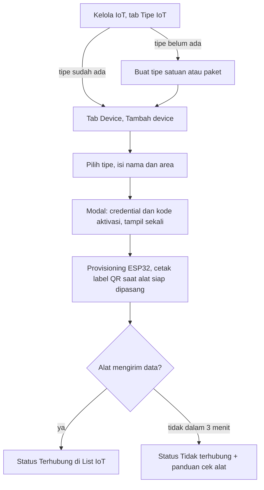
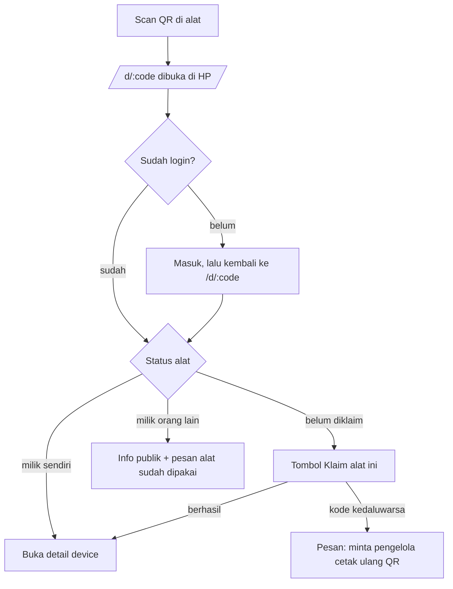
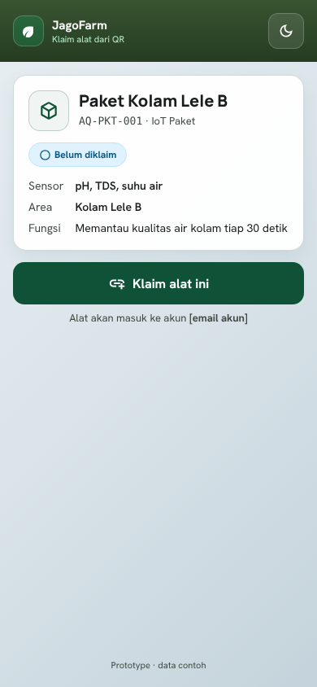
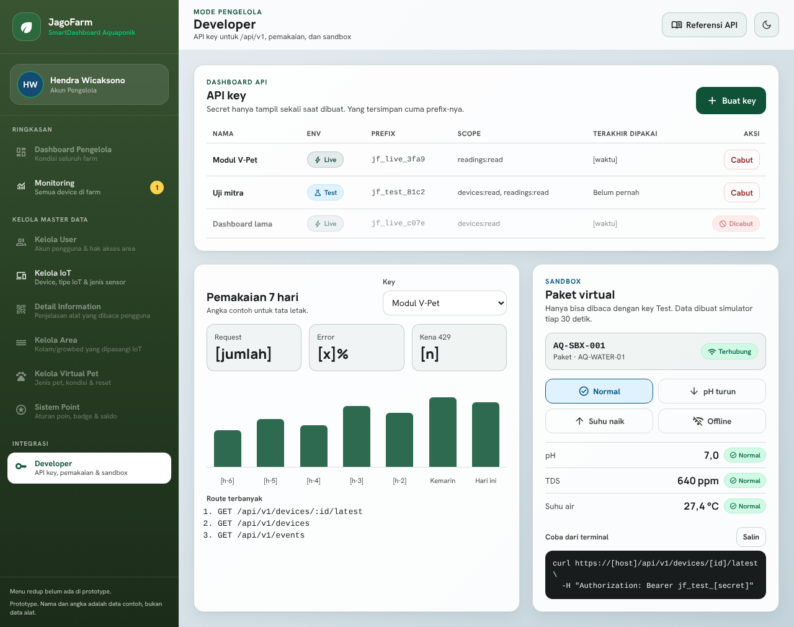

# UI/UX Design: IoT System

| Atribut | Isi |
| --- | --- |
| Status | Draft v0.1 |
| Arah desain | [`DESIGN.md`](../../DESIGN.md) (tema Lumina Aqua, dial ENERGY 1 / RHYTHM 2 / MOTION 1) |
| Komponen | [Design System](06-design-system.md) |
| Gambar desain | [design/README.md](design/README.md) |

## 1. Prinsip

Ketiga prinsip ini diambil dari `DESIGN.md` dan dipakai untuk memutuskan setiap layar IoT:

1. **Angka dulu.** Nilai sensor dan statusnya adalah fokus utama setiap layar monitoring. Elemen lain mengikuti.
2. **Status selalu tertulis.** Warna hanya memperkuat. Setiap status punya label teks dan ikon.
3. **Tenang.** Tidak ada animasi masuk dan tidak ada gerakan berulang. Update live hanya mengganti angka, tanpa efek kedip.

Tambahan khusus IoT:

4. **Jujur soal kesegaran data.** Setiap nilai menampilkan kapan diukur. Data yang sudah lewat 90 detik ditandai "Data tertunda", bukan ditampilkan seolah-olah baru.
5. **Lapangan dulu untuk scan QR.** Halaman klaim dibuka dari HP di pinggir kolam, jadi dirancang untuk layar sempit dan satu tangan.

## 2. Peran dan tujuan

| Peran | Tujuan utama di IoT | Perangkat yang dipakai |
| --- | --- | --- |
| Pengguna lapangan | Tahu kondisi air sekarang, tahu kapan harus bertindak, klaim alat baru | HP saat di kolam, laptop saat rekap |
| Pengelola | Daftarkan alat, cetak QR, atur ambang, pantau seluruh farm | Laptop (Windows skala 150%, lebar efektif 841 px) |
| Developer / mitra | Buat key, coba API, pantau pemakaian | Laptop |

## 3. Arsitektur informasi

Menu baru diberi tanda (baru) dan menu yang berubah diberi tanda (diubah).

```
Pengguna
├── Dashboard
├── List IoT (diubah)              sumber data dari API, filter tipe satuan/paket
│   └── Detail device (diubah)     /iot/:id
├── Monitoring (baru)              /monitoring, tab Per paket · Per sensor · Per area
├── Detail Information (diubah)    scan QR, sekarang juga bisa klaim dan input kode manual
└── Kelola Area, V-Pet, Gamifikasi, Chatbot (tetap)

Pengelola
├── Dashboard Pengelola
├── Monitoring (baru)              sama dengan pengguna, melihat semua device
├── Kelola IoT (diubah)            /admin/iot, tab Device · Tipe IoT · Jenis Sensor
├── Kategori Device                dihapus, isinya pindah ke tab Jenis Sensor
├── Developer (baru)               /developer, API key, pemakaian, sandbox
└── menu lain tetap

Publik
├── /d/:code (baru)                halaman tujuan QR, mobile-first
└── /docs (baru)                   referensi API, dilayani backend
```

Gambarnya ada di [design/README.md](design/README.md).

Menu Developer tampil untuk pengguna dan pengelola. Pengguna hanya dapat membuat key Test tanpa scope `admin`; pengelola dapat membuat key Test atau Live. Backend tetap menjadi penegak akhir kebijakan Q2 dan Q3.

## 4. Alur utama

### 4.1 Pengelola mendaftarkan alat sampai terpasang



Kode aktivasi di label berlaku 24 jam ([ADR-0009](adr/0009-qr-dicetak-saat-pemasangan.md)). Kalau pemasangan tertunda, pengelola menekan "Buat ulang kode aktivasi" di baris device lalu mencetak label baru.

### 4.2 Pengguna mengklaim alat lewat QR



Kalau browser tidak mendukung `BarcodeDetector` (Safari dan Firefox saat dokumen ini ditulis), `QrScanner.jsx` menampilkan pesan dan form kode manual. Halaman Detail Information juga menyediakan input kode alat. Pemindai kamera bawaan ponsel tetap bisa membuka URL `/d/:code` yang tersimpan di QR.

### 4.3 Pengguna menanggapi nilai di luar ambang

1. Kartu sensor berubah ke status "Di bawah ambang" atau "Di atas ambang", lengkap dengan ikon dan teks.
2. Badge menu Monitoring menampilkan label aksesibel `[n] kejadian perlu perhatian`; n adalah jumlah ID device live berbeda yang berstatus `offline` atau memiliki sedikitnya satu latest reading `low`/`high`. Device `stale` tanpa alert tidak dihitung, sedangkan `stale` dengan alert tetap dihitung. Sandbox dan state `unknown` dikecualikan, satu device hanya dihitung sekali, dan badge disembunyikan saat n = 0.
3. Pengguna membuka grafik sensor dan melihat garis ambang serta titik saat nilai mulai keluar.
4. Log kejadian mencatat kapan nilai keluar ambang dan kapan kembali normal.

### 4.4 Developer membuat key dan melihat pemakaian

1. Buka Developer, klik Buat key, pilih environment dan scope yang diizinkan untuk peran akun.
2. Modal menampilkan secret satu kali, dengan tombol salin dan peringatan bahwa secret tidak bisa dilihat lagi.
3. Pilih key untuk melihat request, persentase error, respons 429, grafik harian, dan maksimal lima route dari data usage API.
4. Klik "Referensi API" untuk membuka dokumen OpenAPI JSON (`/docs/openapi.json`) di tab baru. Scalar tetap direncanakan untuk Minggu 4.
5. Panel Sandbox menyediakan satu device Test milik akun, pilihan skenario, pembacaan pH/state/kejadian terbaru, dan contoh `curl` yang hanya memakai prefix aman serta placeholder secret.

## 5. Spesifikasi layar

Setiap layar yang menampilkan data wajib punya empat state: loading, kosong, error, dan berisi. Pesan error memakai teks dari backend (`error.message`), tidak boleh diganti data contoh.

### 5.1 List IoT (`/iot`), diubah

| Bagian | Isi |
| --- | --- |
| Ringkasan | 4 StatCard: Total device, Terhubung, Data tertunda, Tidak terhubung |
| Filter | Cari, Tipe (Semua, Satuan, Paket), Area, Status |
| Daftar | Kartu device menampilkan identitas, badge tipe/status, dan pembacaan tiap sensor dari `GET /devices/:id/latest`, termasuk state serta ambang efektif. Nilai `null` menampilkan "Belum ada data. Pastikan alat sudah diprovisioning dan tersambung WiFi."; nilai ilustrasi screenshot tidak pernah dipakai sebagai telemetry. Di mode API, pembacaan diperbarui lewat fetch streaming; mode local tetap menandai "Data contoh" dan tidak mengarang nilai |
| Loading | Teks "Memuat perangkat..." dengan `role="status"` |
| Kosong (belum punya device) | "Belum ada perangkat di akun ini." + tombol "Scan QR alat" |
| Kosong (hasil filter) | "Tidak ada device cocok" (teks yang sudah ada) |
| Error | Pesan dari backend + tombol "Coba lagi" |

Kartu IoT paket menampilkan semua sensornya dalam satu kartu. IoT satuan menampilkan nilai sensor dengan penekanan visual. Kegagalan memuat pembacaan ditampilkan di area pembacaan tanpa mengganti data device atau nilai sebelumnya dengan data contoh.

Gambar: [berisi](design/screens/01-list-iot.png), [gelap](design/screens/01b-list-iot-gelap.png), [kosong](design/screens/01c-list-iot-kosong.png), [error](design/screens/01d-list-iot-error.png), [loading](design/screens/01e-list-iot-loading.png), [HP](design/screens/01f-list-iot-hp.png).

### 5.2 Detail device (`/iot/:id`), diubah

| Bagian | Isi |
| --- | --- |
| Kepala | Nama, kode, badge tipe, badge status, tombol Lepas alat (pemilik). Tombol QR hanya untuk pengelola, jadi tidak tampil di gambar yang memakai sudut pandang pengguna |
| Nilai sekarang | Nilai terbaru, state, waktu ukur, dan ambang efektif dari API. Ambang `/latest` adalah acuan; nilai `null` menampilkan "Belum ada data. Pastikan alat sudah diprovisioning dan tersambung WiFi." |
| Grafik | Riwayat 24 jam untuk sensor terpilih, diringkas per 5 menit dengan rata-rata, rentang minimum-maksimum, dan ambang efektif. Ringkasan terakhir/min/maks menyertakan satuan sensor. Error riwayat ditampilkan di bagian grafik |
| Kejadian | Maksimal 10 perubahan ambang dan koneksi terbaru dari API. Error kejadian ditampilkan di bagian ini |
| Kesehatan unit | Firmware, RSSI, kalibrasi terakhir, kiriman terakhir |
| Fungsi alat | Daftar fungsi alat, teks yang sama dengan yang tampil saat QR dipindai |

Status koneksi menunjukkan "Live" saat fetch stream tersambung, "Menyambung ulang..." saat stream yang sempat aktif terputus, atau "Diperbarui tiap 30 detik" saat fallback polling. Server mengirim komentar SSE awal setelah header HTTP 200 di-flush agar fetch client di balik proxy segera menerima respons dan menampilkan "Live" tanpa menunggu heartbeat. Kegagalan koneksi awal atau reconnect, termasuk 429, memulai satu interval polling dan retry stream berbatas backoff; retry tidak berjalan sebelum `Retry-After`. HTTP 200 menghentikan polling. Reconnect dilakukan satu per satu dengan `Last-Event-ID`; server me-replay event setelah cursor, termasuk event yang tersimpan selama gap tanpa GET `/events` tambahan, dan client mengabaikan ID duplikat.

Gambar: [terang](design/screens/02-detail-device.png), [gelap](design/screens/02b-detail-device-gelap.png).

### 5.3 Monitoring (`/monitoring`), baru

Monitoring memiliki tepat tiga tab kategori: **Per paket**, **Per sensor**, dan **Per area**. Panel **Log kejadian** selalu menyertai tampilan aktif—di sampingnya pada desktop dan di bawahnya pada layar sempit.

Tab **Per paket**: kartu menampilkan device paket dari hasil API yang diizinkan untuk sesi, termasuk sandbox bila dikembalikan API. Setiap record sandbox diberi label teks **Sandbox**. Kartu menampilkan nilai terbaru, state, ambang efektif, waktu ukur, dan sparkline 24 jam per sensor; overview dan update stream mengikuti record yang dikembalikan/diizinkan API. Sparkline memakai titik riwayat API; label aksesibelnya menyebut nama sensor serta min/maks dari rentang yang sama. Tidak ada metrik contoh saat request gagal.

Tab **Per sensor**: pilihan jenis sensor berasal dari `GET /sensor-types`. Ringkasan memakai `GET /sensors/:code/overview`, lalu menggabungkan item dengan metadata device dan tipe dari daftar API yang diizinkan. Tabel berisi device satuan maupun paket yang memiliki sensor tersebut, termasuk sandbox bila dikembalikan API; setiap baris sandbox diberi label teks **Sandbox**. Kolom lain berisi kode dan tipe, area, nilai/state, ambang efektif, dan waktu ukur. Device `low`/`high` berada paling atas. Pilih maksimal 3 device untuk grafik perbandingan 24 jam dari API, memakai warna token `primary`, `tertiary`, dan `secondary`.

Tab **Per area**: hanya device live non-sandbox yang memiliki `areaRef` aktual. Untuk setiap pasangan device/sensor, klien meminta `GET /devices/:id/readings?sensor=<code>&from=<local midnight>&to=<now>&bucket=5m`. Awal rentang memakai tengah malam zona waktu browser dan labelnya tepat **"Hari ini sejak 00.00 (waktu perangkatmu)"**. Min adalah nilai minimum dari semua `min` bucket, maks adalah nilai maksimum dari semua `max`, dan rata-rata digabung berbobot jumlah sampel `sum(avg*n)/sum(n)`, bukan rata-rata dari rata-rata bucket. Refresh otomatis berjalan saat tab Per area dibuka dan setiap 5 menit (`300.000 ms`) selama dokumen terlihat. Saat dokumen tersembunyi, timer berhenti dan fetch aktif dibatalkan; saat terlihat kembali, refresh dicoba segera. Tombol **Muat ulang** memulai refresh manual tanpa menunggu interval, tetapi tetap menghormati perlindungan batch bersamaan dan sub-anggaran 60 request per jendela bergulir 60 detik. Maksimal 60 route per batch; counter menunjukkan sisa dari sub-anggaran area tersebut. Frame SSE tidak memicu pemuatan ulang histori area.

Panel **Log kejadian** memfilter kejadian menurut device dan tipe melalui `GET /events?deviceId=&type=&cursor=&limit=`. Device sandbox yang ada di hasil API terotorisasi tetap tersedia dalam filter dan event-nya tetap tampil di feed; opsi filter dan baris sandbox diberi label teks **Sandbox**. Device Detail juga menandai record sandbox dengan label teks **Sandbox**. Tombol halaman berikutnya meneruskan cursor dan hasil digabung tanpa ID duplikat. Panel menampilkan status loading, kosong, error, dan ready tanpa mengganti kegagalan API dengan data contoh. Baris diurutkan menurut ID numerik menurun sesuai kontrak, sementara waktu yang ditampilkan berasal dari `at`.

Badge Monitoring pada kedua menu menghitung jumlah ID device live berbeda yang berstatus `offline` atau memiliki sensor latest state `low`/`high`. Satu device hanya dihitung sekali; sandbox dan state `unknown` dikecualikan. Device berstatus `stale` tidak dihitung hanya karena stale, tetapi tetap dihitung jika statusnya offline atau ada sensor `low`/`high`. Badge disembunyikan saat hitungan nol. Sumber badge adalah satu daftar device dan satu overview per jenis sensor, diperbarui paling sering sekali per 60 detik saat dokumen terlihat. Kegagalan sumber mempertahankan hitungan valid terakhir atau menyembunyikan badge bila belum pernah berhasil, bukan mengganti error dengan nol.

Gambar: [per paket](design/screens/03-monitoring-per-paket.png), [per sensor](design/screens/03b-monitoring-per-sensor.png), [per area](design/screens/03c-monitoring-per-area.png), [gelap](design/screens/03d-monitoring-gelap.png).

### 5.4 Kelola IoT (`/admin/iot`), diubah jadi 3 tab

Tab **Device**: tabel device dengan kolom tipe dan kiriman terakhir. Aksi per baris: Label QR, Ubah, Buat ulang kode aktivasi, Catat kalibrasi, dan rotasi credential jika memenuhi syarat. Aksi rotasi hanya tampil untuk device live dengan `credentialProvisioned: true`; aksi disembunyikan untuk sandbox dan device yang belum diprovisikan. `credentialProvisioned` berasal dari `credential_hash IS NOT NULL`, tidak mengungkap hash atau secret. Rotasi memakai `POST /devices/:id/credentials/rotate`; secret hasil rotasi ditampilkan satu kali dan dialog baru boleh ditutup setelah secret disalin atau pengguna menyatakan sudah menyimpannya. Area tidak memiliki endpoint API, sehingga `areaRef` dapat dibiarkan kosong atau diisi manual tanpa pilihan area contoh.

Catatan implementasi Tahap frontend 2: aksi **Nonaktifkan** pada screenshot 04 tidak ditampilkan. Kontrak server belum memiliki field maupun route untuk menonaktifkan device; UI tidak membuat tombol atau operasi pengganti. Screenshot 04 tetap menjadi acuan tata letak, bukan kontrak operasi.

Tab **Tipe IoT**: tabel tipe (kode, nama, jenis, sensor, jumlah device, status) dengan aksi Ubah, Nonaktifkan, atau Aktifkan. Tipe nonaktif tidak bisa dipakai untuk device baru. Form tambah tipe:

- Pilihan jenis: Satuan atau Paket (radio).
- Satuan menampilkan satu select sensor. Paket menampilkan daftar checkbox sensor dengan isian label per sensor.
- Validasi langsung: "Paket butuh minimal 2 sensor."
- Kode tipe dikunci kalau tipe sudah punya device.

Tab **Jenis Sensor**: menggantikan menu Kategori Device. Form berisi kode, nama, satuan, rentang valid, desimal, dan ambang default.

Gambar: [device](design/screens/04-kelola-iot-device.png), [tipe](design/screens/04b-kelola-iot-tipe.png), [jenis sensor](design/screens/04c-kelola-iot-jenis-sensor.png), [tambah device](design/screens/04d-kelola-iot-tambah-device.png), [device dibuat](design/screens/04e-kelola-iot-device-dibuat.png), [label QR](design/screens/04f-kelola-iot-label-qr.png), [tambah tipe paket](design/screens/05-tambah-tipe-paket.png), [tambah tipe satuan](design/screens/05b-tambah-tipe-satuan.png).

### 5.5 Halaman tujuan QR (`/d/:code`), baru, mobile-first



Tombol Klaim setinggi 52 px dan selebar layar, supaya mudah ditekan dengan satu tangan di pinggir kolam.

Jika QR membawa kode aktivasi, halaman menyalinnya ke memori JavaScript sementara lalu segera mengganti entri history agar query `c` hilang dari address bar. Alur ke `/masuk` hanya meneruskan `/d/:code`; Shell dan form Login mempertahankan tujuan ini hanya jika cocok dengan satu kode device internal yang valid. Redirect Shell saat sesi menjadi authenticated mencegah guard route membuang tujuan QR sebelum Login menyelesaikan transisi. Setelah login, kode dipulihkan dari memori tanpa menaruhnya di router state. Kode dihapus setelah klaim berhasil, saat logout mulai, atau setelah 10 menit. Kode tidak disimpan di localStorage/sessionStorage, SmartStore, URL setelah penukaran history, maupun log. Input kode manual tetap tersedia sebagai fallback dan mengikuti masa hidup memori yang sama.

State yang wajib ada: belum login, belum diklaim, milik sendiri, milik orang lain, kode kedaluwarsa, kode tidak dikenal, dan backend tidak tersedia. Gambar semua state ada di [design/README.md](design/README.md), termasuk [mode gelap](design/screens/07i-klaim-qr-gelap.png).

Pratinjau publik hanya menampilkan nama, kode, tipe, sensor, status klaim, dan validitas kode aktivasi. Area/kolam, readings, identitas akun, credential, dan kode aktivasi tidak ditampilkan. Informasi area menunggu keputusan Q4.

### 5.6 Developer (`/developer`), baru



Isinya tautan "Referensi API" yang membuka OpenAPI JSON di `/docs/openapi.json` pada tab baru, tabel API key (nama, environment, prefix, scope, terakhir dipakai, status, aksi Cabut), panel pemakaian 7 hari per key dari GET `/keys/:id/usage`, dan panel Sandbox. Panel Sandbox memanggil `GET /sandbox/devices` untuk memperoleh device Test aktual milik akun, lalu menampilkan status koneksi, pH latest beserta state/ambang/waktu, dan kejadian terbaru. Skenario `normal`, `ph_turun`, `suhu_naik`, atau `offline` disimpan ke `PUT /sandbox/devices/:id/scenario`. Pembaruan memakai subscriber `iotStreamClient` bersama, tanpa membuat stream kedua; callback `onRefresh` bersama hanya memperbarui sandbox pada fallback polling 30 detik. Contoh `curl` yang dapat disalin memuat prefix key Test yang aman dan variabel `JAGOFARM_TEST_API_KEY`, bukan secret.

Modal secret key:

- Judul: "Simpan key ini sekarang".
- Isi: secret dalam blok kode dengan tombol Salin, dan kalimat "Key ini tidak akan ditampilkan lagi. Kalau hilang, cabut lalu buat key baru."
- Tombol Tutup baru aktif setelah tombol Salin ditekan, atau setelah kotak "Sudah saya simpan" dicentang.

Konfirmasi cabut key: "Cabut key [nama key]? Semua request dengan key ini langsung ditolak." Tombolnya "Cabut key" (danger) dan "Batal".

Gambar: [secret key](design/screens/06c-secret-key.png), [secret key gelap](design/screens/06d-secret-key-gelap.png), [Developer gelap](design/screens/06b-developer-gelap.png).

## 6. Status dan teks

### 6.1 Status koneksi

| Backend | Label | Ikon (Material Symbols) | Tone Badge |
| --- | --- | --- | --- |
| `online` | Terhubung | `wifi` | `ok` |
| `stale` | Data tertunda | `schedule` | `warn` |
| `offline` | Tidak terhubung | `wifi_off` | `bad` |
| Kalibrasi lewat jatuh tempo | Perlu kalibrasi | `build` | `info` |
| Device baru, belum diklaim | Menunggu klaim | `hourglass_top` | `info` |

### 6.2 State ambang

| `state` | Label | Ikon | Tone |
| --- | --- | --- | --- |
| `normal` | Normal | `check_circle` | `ok` |
| `low` | Di bawah ambang | `arrow_downward` | `warn` |
| `high` | Di atas ambang | `arrow_upward` | `warn` |
| `unknown` | Tanpa ambang | `remove` | `muted` |

### 6.3 Teks penting

| Situasi | Teks |
| --- | --- |
| Backend mati | "Backend tidak tersedia. Data contoh tidak digunakan sebagai pengganti." (teks `pilotApi.js` yang sudah ada) |
| Device baru belum kirim data | "Belum ada data. Pastikan alat sudah diprovisioning dan tersambung WiFi." |
| Klaim berhasil | "AQ-PKT-001 sudah masuk ke akun Anda." |
| Kode aktivasi kedaluwarsa | "Kode di QR ini sudah kedaluwarsa. Minta pengelola mencetak ulang QR." |
| Alat milik orang lain | "Alat ini sudah dipakai akun lain. Hubungi pengelola kalau ini keliru." |

## 7. Aksesibilitas dan responsif

- Kontras teks minimal WCAG AA di mode terang dan gelap. Warna status memakai tone Badge yang sudah ada, karena tone itu sudah punya varian gelap.
- Semua aksi bisa dijalankan dengan keyboard. Saat modal dibuka, fokus pindah ke elemen pertama di dalamnya, Tab dan Shift+Tab berputar di dalam dialog, Escape menutup, dan fokus kembali ke tombol pemicu yang direferensikan, bukan ke `body`. Konfirmasi rotasi dan dialog reveal credential memakai ref tombol pemicu yang sama. Pola ini dipasang sekali di komponen `Modal` (`ui.jsx`).
- Tombol yang berulang di tabel punya nama aksesibel yang menyebut barisnya, misalnya "Nonaktifkan AQ-TMP" atau "Buat ulang kode aktivasi AQ-PH-002". Label `select` dipasang dengan `for`/`id`, bukan membungkus `select`, supaya namanya tidak tercampur teks opsi.
- Status stream/polling List IoT memakai `role="status"` dan `aria-live="polite"`; region hanya mengumumkan transisi status, bukan setiap refresh polling 30 detik. Nilai yang berubah lewat SSE diumumkan lewat region `aria-live="polite"`, hanya ketika state ambang berubah, bukan setiap angka berubah.
- Target sentuh minimal 44 px untuk halaman `/d/:code` dan tombol utama di layar sempit.
- Grafik punya ringkasan teks di bawahnya (nilai terakhir, min, maks, masing-masing dengan satuan sensor) supaya informasinya tetap terbaca tanpa melihat grafik.
- Tidak ada scroll horizontal di lebar 360 px. Ini sudah diuji di prototype untuk List IoT, Detail device, Monitoring, Kelola IoT, Developer, dan halaman QR. Tabel lebar memakai kotak scroll horizontal sendiri, jadi halaman tidak ikut bergeser.
- Di lebar 720 px ke bawah, sidebar disembunyikan dan diganti tombol Menu (44 px) di top bar. Ini usulan perubahan untuk `SmartSidebar`, karena sidebar 208 px yang selalu tampil menyisakan sekitar 180 px untuk konten di HP.
